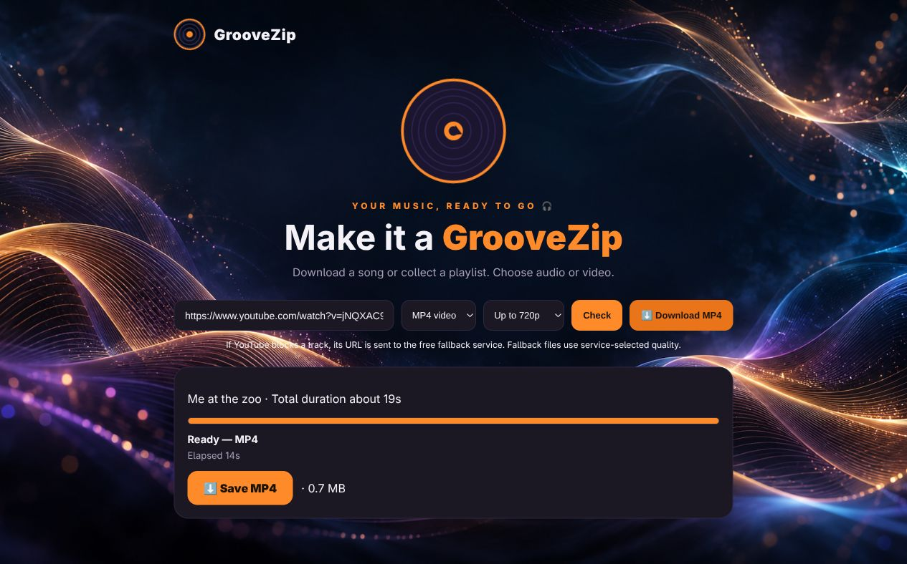

<p align="center">
  
</p>

# GrooveZip

A local web app for downloading a public YouTube video as **MP3 audio** or **MP4 video**, or collecting a playlist into one **ZIP**. Paste a link, choose a format, and follow the progress in your browser.



## What it does

- Individual videos: download an MP3 or MP4 directly.
- Playlists: download the available tracks in order and save them together as a ZIP.
- MP3: choose 128, 192, 256, or 320 kbps for local conversions.
- MP4: choose a maximum resolution of 480p or 720p.
- Download jobs run serially, with shared cooldowns and automatic retries when the service rate-limits requests.
- Progress includes playlist duration, elapsed time, and an approximate time remaining that adapts as tracks finish.
- Partial playlists include a `missing-tracks.csv` report with unavailable or unattempted entries.
- Temporary media and fragments are cleaned up after packaging. Finished files and job records are removed after a successful browser transfer; interrupted transfers remain available for retry.

## Run locally

### Requirements

- Python **3.10+**
- Node.js **22+**, available on `PATH` ([yt-dlp runtime requirements](https://github.com/yt-dlp/yt-dlp/wiki/EJS))
- `ffmpeg` and `ffprobe`
- `curl`
- Python dependencies in [`requirements.txt`](requirements.txt)

On Debian or Ubuntu, install the media tools with:

```bash
sudo apt-get update
sudo apt-get install ffmpeg curl python3-venv
```

Install Node.js from [the official download page](https://nodejs.org/en/download) or your package manager, then:

```bash
git clone https://github.com/benclawbot/groovezip.git
cd groovezip
python3 -m venv .venv
.venv/bin/python -m pip install -r requirements.txt
./run.sh
```

Open **[http://127.0.0.1:8787](http://127.0.0.1:8787)**. The server runs until you stop it with `Ctrl+C`; no startup service is installed.

`run.sh` uses `.venv/bin/python` when present and falls back to `python3`. To choose a different port:

```bash
PORT=9000 ./run.sh
```

The default bind address is `127.0.0.1`. `HOST`, `PORT`, and the legacy `YTD_PORT` setting are supported.

## Use it

1. Paste a YouTube video or playlist link.
2. Choose **MP3 audio** or **MP4 video**, then bitrate or resolution.
3. Click **Download**. **Check** is optional and previews the title, duration, and playlist entries.
4. Follow progress and any cooldown countdown.
5. When ready, click **Save MP3**, **Save MP4**, or **Save the ZIP**.

A `/playlist?list=…` link downloads the playlist. A video link downloads only that video, even when its URL also contains a playlist parameter. `youtu.be` and `/shorts/…` links are supported.

### Rate limits and time estimates

GrooveZip honors `Retry-After` delays, including HTTP dates and long cooldowns. A rate limit pauses and retries the current request instead of marking the rest of the playlist as failed. Shared cooldowns keep queued jobs from immediately repeating blocked requests. Temporary network and server failures use bounded retries and backoff; unavailable videos are reported separately.

The time estimate starts from track count and total media duration, then adjusts using observed progress. Queue waits and current cooldowns are included. It is approximate: file size, conversion speed, network conditions, and later rate limits can change the completion time.

### Public downloads and the free fallback

The app uses [yt-dlp](https://github.com/yt-dlp/yt-dlp) and ffmpeg locally. It does not ask for YouTube sign-in, browser cookies, or session files. If YouTube blocks local downloads, eligible public video URLs are sent to the existing free [WebDownloader API](https://save.brianrianrehan.com/docs).

The fallback service has its own rate limits and a roughly 2 GB file limit. Fallback MP3s retain the service's audio quality. Private, removed, age-restricted, or otherwise unavailable videos may not download; neither yt-dlp nor the fallback guarantees access to every entry.

## File lifecycle

Local job files live in `downloads/`, which is excluded from Git.

| Stage | Files retained |
| --- | --- |
| Downloading or converting | Current job's media and temporary fragments |
| Playlist ZIP ready | ZIP only; raw media and fragments removed |
| Individual file ready | Final MP3 or MP4 only |
| Transfer interrupted | Finished file retained so the save link can be retried |
| Transfer completed | Finished file, temporary job directory, and job record removed |

Jobs and queues are held in memory and do not resume after a server restart. The app is intended for one local process, not multiple load-balanced instances.

## HTTP API

Requests and status responses use JSON. Download URLs require an HTTPS YouTube URL on an allowed YouTube host.

| Method | Endpoint | Request | Result |
| --- | --- | --- | --- |
| `POST` | `/api/check` | `{"url":"…"}` | Title, count, duration, and preview entries |
| `POST` | `/api/download` | `{"url":"…","format":"mp3","quality":192}` | `{"id":"…"}` |
| `POST` | `/api/download` | `{"url":"…","format":"mp4","resolution":720}` | `{"id":"…"}` |
| `GET` | `/api/status?id=…` | — | State, progress, cooldown, elapsed time, and estimate |
| `GET` | `/api/file?id=…` | — | Finished individual MP3 or MP4 |
| `GET` | `/api/zip?id=…` | — | Finished playlist ZIP |
| `GET` | `/health` or `/healthz` | — | `{"status":"ok"}` |

```bash
curl -X POST http://127.0.0.1:8787/api/download \
  -H 'Content-Type: application/json' \
  -d '{"url":"https://www.youtube.com/watch?v=VIDEO_ID","format":"mp4","resolution":720}'
```

Poll the returned job ID until `state` is `done`, then use the appropriate file or ZIP endpoint. A successful transfer consumes the result; request a new job to download it again.

## Docker

The image includes Python, ffmpeg, curl, Node.js, yt-dlp, and the pinned anonymous bgutil token provider. The provider listens inside the container and starts with the app.

```bash
docker build -t groovezip .
docker run --rm -p 127.0.0.1:8787:8787 \
  -e HOST=0.0.0.0 -e PORT=8787 groovezip
```

Open `http://127.0.0.1:8787`. Container downloads use `/app/downloads`. Container replacement loses in-memory jobs, and cloud IP addresses may encounter additional YouTube blocks.

## Development and checks

```bash
python3 -m unittest discover -s tests -v
node tests/test_frontend.js
python3 -m py_compile app.py
git diff --check
```

The GitHub validation workflow also builds the Docker image and checks container startup, health, and bundled dependencies. Live media availability depends on external services, so deterministic tests use controlled responses and local media fixtures.

## Troubleshooting

- **The job is waiting:** read the queue or cooldown status; it will retry automatically when the wait ends.
- **Some tracks are missing:** inspect `missing-tracks.csv` in the partial ZIP for the affected entries.
- **A long video exceeds the fallback limit:** the service may reject it even when shorter videos work.
- **yt-dlp cannot find its runtime or media tools:** check `node --version`, `ffmpeg -version`, and `ffprobe -version`, and update Python dependencies with `.venv/bin/python -m pip install -U -r requirements.txt`.
- **A saved result returns 404:** completed transfers are deleted automatically. Start a new job if you need another copy.
